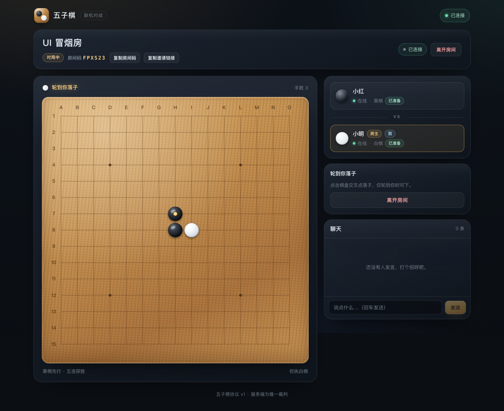

# 棋类游戏 · 联机对战（React + TypeScript / Python）

一个可外网连接的**多游戏联机大厅**：目前包含 **五子棋** 与 **中国象棋**，前端 React 18 + TypeScript + Vite，后端 Python 3.11 + FastAPI + WebSocket。服务端是唯一裁判，前端只做展示与乐观交互。

> 项目原名 `gomoku`，现更名为 **games**；五子棋只是其中一个游戏，新增小游戏只需实现一份 `GameRules` 规则插件。
> 线上游戏中心：`https://games.later.design/`；后端：`https://cloudflare.org.cn/games`，WebSocket：`wss://cloudflare.org.cn/games/ws`。


## 功能

| 模块 | 能力 |
| --- | --- |
| 首页 | 游戏中心：按「棋类对战 / 实时对战」分组展示全部游戏，含开发中游戏卡片 |
| 游戏 | 五子棋（15×15，五连获胜）；中国象棋（9×10，将死/困毙获胜）；坦克大战（规划中，见 [实时传输设计](docs/REALTIME.md)） |
| 联机 | 快速匹配、公开/私密房间、房间码与邀请链接、双方准备开局、观战（最多 20 人） |
| 身份 | HttpOnly `games_session` Cookie（`playerId.token`，30 天）+ localStorage token；刷新/重开浏览器/换标签页可恢复座位 |
| 对局 | 服务端走子校验、悔棋请求/回应、认输、再来一局（自动交换先后手）、断线宽限与弃权结算 |
| 玩法 | 内置电脑对手：五子棋启发式 AI；中国象棋 alpha-beta 搜索 AI |
| 体验 | 五子棋乐观落子 + 落子动画、涟漪、胜利连线；象棋选中/合法落点高亮、将军提示、上一步标记 |
| 音效 | WebAudio 实时合成（落子/胜负/和棋），可静音并记住设置 |
| 战绩 | 每位玩家保留最近 10 局，标记游戏、模式、结果、手数；仅保存在服务端内存 |
| 渲染 | 棋盘全部 **Canvas 2D**（离屏静态层 + 按需重绘 + DPR 自适应），无 SVG/DOM 棋子 |

### 前端路由

每个游戏有独立 URI 与源码目录，新增游戏不需要改 App/Lobby：

| URL | 页面 |
| --- | --- |
| `/` | 游戏中心首页（全部游戏、开发中游戏） |
| `/gomoku`、`/chess` | 对应游戏的大厅 |
| `/gomoku/room/ABC123` | 对局页 / 邀请链接（`{game}/room/{code}`） |
| `/room/ABC123` | 未指定游戏的通用房间入口，加入后规范为 `/{game}/room/{code}` |

旧版 `?game=chess`、`?room=ABC123` 链接仍可用，首帧会自动替换为上面的路径。

新增游戏：在 `web/src/games/<slug>/` 放 `meta.ts` + 棋盘组件，登记到 `registry.ts`，首页和路由自动生效。只是规划中的游戏放 `planned.ts`，不会污染协议 `GameType`。

### 五子棋 / 中国象棋截图

| 五子棋对局 | 中国象棋对局 |
| --- | --- |
|  |  |

| 五子棋终局 | 移动端 |
| --- | --- |
|  |  |

## 技术栈与目录

- 前端：React 18、TypeScript 5.6、Vite 5、纯 CSS（无 UI 组件库、无游戏引擎）
- 后端：Python 3.11、FastAPI、uvicorn、原生 WebSocket
- 部署：前端静态资源由 Nginx / CDN / Cloudflare Workers 托管；后端只提供 `/api` 与 `/ws`，**不托管任何前端文件**

```text
games/
├── server/
│   ├── app/
│   │   ├── main.py          # FastAPI：/api/health、/api/rooms、/api/config + WS
│   │   ├── ws.py            # WebSocket 接入、Cookie 身份、消息分发
│   │   ├── rooms.py         # 游戏无关的房间生命周期 / 悔棋 / 认输 / AI / 战绩
│   │   ├── games/
│   │   │   ├── base.py      # GameRules 插件接口
│   │   │   ├── gomoku.py    # 五子棋规则
│   │   │   └── chess.py     # 中国象棋规则 + AI
│   │   ├── game.py / ai.py  # 五子棋棋盘算法与启发式 AI
│   │   └── protocol.py      # 协议 v2 常量、错误码、校验
│   ├── tests/               # pytest（规则 + 房间 + WebSocket 集成）
│   └── run.py               # CLI 启动入口（--host/--port/--reload）
├── web/
│   └── src/
│       ├── games/
│       │   ├── registry.ts       # 游戏注册表：新增游戏只改这里
│       │   ├── types.ts          # GameDefinition / GameListing
│       │   ├── planned.ts        # 开发中游戏（坦克大战）
│       │   ├── gomoku/
│       │   │   ├── meta.ts       # /gomoku 的路由与文案
│       │   │   └── Board.tsx     # 五子棋 Canvas 棋盘
│       │   └── chess/
│       │       ├── meta.ts       # /chess 的路由与文案
│       │       └── ChessBoard.tsx
│       ├── components/
│       │   ├── Home.tsx          # 游戏中心首页
│       │   ├── Lobby.tsx         # 大厅（游戏切换跳 URI）
│       │   ├── RoomView.tsx      # 通用对局页
│       │   └── ...
│       ├── hooks/useGameSocket.ts# WS 状态机 + 动作
│       ├── lib/router.ts         # /{game}、/{game}/room/{code} 路径路由
│       ├── lib/protocol.ts       # 运行时协议解析
│       └── types.ts              # 多游戏类型
├── deploy/nginx.container.conf
├── Dockerfile / Dockerfile.web / docker-compose.yml
├── PROTOCOL.md                  # 协议 v2（含两种 game 状态）
├── docs/REALTIME.md             # 实时游戏 tick / 二进制 WS 设计（v3 草案）
└── scripts/                     # start/dev/e2e/ui_smoke
```

## 快速开始（开发模式）

```bash
# 后端（仓库根目录）
./scripts/dev.sh              # uvicorn 热重载，默认 127.0.0.1:8765

# 前端（另开终端）
cd web
npm install
npm run dev                   # http://127.0.0.1:5173
```

Vite 已把 `/api` 与 `/ws` 代理到 `http://127.0.0.1:8765`；也可以用 `DEV_BACKEND=http://host:port npm run dev` 指定其他后端。

### 手动启动

```bash
python3 -m venv server/.venv && server/.venv/bin/pip install -r server/requirements.txt
cd server && .venv/bin/python run.py --host 0.0.0.0 --port 8765 --reload

cd web && npm run dev
```

> 监听地址/端口只由启动参数决定，不从 `.env` 读取端口；应用配置从仓库根 `.env` 或 `server/.env` 读取。

## 生产部署（前端静态资源 + 后端 API/WS）

前端与后端分开部署，后端**不提供静态文件**。

```bash
# 1) 构建前端（构建期注入部署地址）
cd web
VITE_BASE_PATH=/games/ \
VITE_API_BASE=https://cloudflare.org.cn/games \
VITE_WS_URL=wss://cloudflare.org.cn/games/ws \
npm run build

# 2) 启动后端
cd ..
./scripts/start.sh --host 127.0.0.1 --port 8765
```

把 `web/dist` 部署到 `https://example.com/games/`；Nginx 参考：

```nginx
location /games/ {
    alias /www/wwwroot/games/web/dist/;
    index index.html;
    try_files $uri $uri/ /games/index.html;
    location = /games/index.html { add_header Cache-Control "no-cache"; }
    location ~* ^/games/assets/ {
        add_header Cache-Control "public, max-age=31536000, immutable";
    }
}

# REST：/games/api/* → 后端 /api/*
location /games/api/ {
    proxy_pass http://127.0.0.1:8765/api/;
    proxy_set_header Host $host;
    proxy_set_header X-Real-IP $remote_addr;
    proxy_set_header X-Forwarded-For $proxy_add_x_forwarded_for;
    proxy_set_header X-Forwarded-Proto $scheme;
}

# WebSocket：/games/ws → 后端 /ws
location = /games/ws {
    proxy_pass http://127.0.0.1:8765/ws;
    proxy_http_version 1.1;
    proxy_set_header Upgrade $http_upgrade;
    proxy_set_header Connection "upgrade";
    proxy_set_header Host $host;
    proxy_read_timeout 3600s;
}
```

### systemd

```ini
# /etc/systemd/system/games-api.service
[Unit]
Description=Games API/WS (Gomoku + Chinese Chess)
After=network.target

[Service]
WorkingDirectory=/www/wwwroot/games
EnvironmentFile=/www/wwwroot/games/.env
ExecStart=/www/wwwroot/games/server/.venv/bin/python server/run.py --host 127.0.0.1 --port 8765
Restart=on-failure
RestartSec=3

[Install]
WantedBy=multi-user.target
```

```bash
sudo systemctl daemon-reload
sudo systemctl enable --now games-api
```

### Docker

```bash
docker compose up -d --build
# 前端 http://localhost:8080，Nginx 容器内把 /api、/ws 反代到 api 容器
```

### Cloudflare Workers（前端静态资源）

线上 Worker `games` 绑定自定义域 `https://games.later.design/`，部署在域名**根路径**，因此构建时 `VITE_BASE_PATH=/`。

`web/wrangler.jsonc` 已配置 `assets.directory = "./dist"` 与 SPA 回退（`/{game}/room/{code}` 刷新时回落到 `index.html`）。部署务必使用构建产物：

```bash
cd web
npm run deploy        # = npm run build && wrangler deploy，上传的是 dist/
```

> ⚠️ 不要直接把 `web/` 源码目录当静态资源上传：HTML 里的 `/src/main.tsx` 没有 MIME，
> 浏览器会报 “Expected a JavaScript-or-Wasm module script…”，页面纯黑。
> 若前端改部署到子路径（如 `https://cloudflare.org.cn/games/`），构建时设 `VITE_BASE_PATH=/games/` 并重新构建。

### 前后端分域部署

同域部署无需 CORS；分域时配置后端 `CORS_ORIGINS=https://your-frontend.example.com`（当前前端是 `https://games.later.design`，后端是 `https://cloudflare.org.cn/games`，需要把前者加入 CORS），前端通过 `VITE_API_BASE` / `VITE_WS_URL` 指到后端域名。`games_session` Cookie 的 `SameSite=Lax`，跨站场景需要放到同一站点下或改用 token 认证。

## 环境变量

### 后端（`server/.env` 或仓库根 `.env`）

| 变量 | 默认 | 说明 |
| --- | --- | --- |
| `BOARD_SIZE` | `15` | 五子棋棋盘路数（5–25） |
| `CORS_ORIGINS` | 本地 5173 | 允许跨域的前端 Origin，逗号分隔 |
| `ALLOWED_ORIGINS` | 空 | 额外允许的 Origin（可选） |
| `ROOM_TTL_SECONDS` | `21600` | 空 waiting 房间回收时间；`0` 关闭 |
| `DISCONNECT_GRACE_SECONDS` | `60` | 掉线宽限，超时按弃权结算 |
| `HOST` / `PORT` | — | 不使用；监听地址只由 `run.py --host/--port` 决定 |

### 前端（Vite 构建期变量）

| 变量 | 默认 | 说明 |
| --- | --- | --- |
| `VITE_BASE_PATH` | `/` | 子路径部署，如 `/games/` |
| `VITE_API_BASE` | 空（同源） | REST 基础地址，如 `https://cloudflare.org.cn/games` |
| `VITE_WS_URL` | 同源 `/ws` | WebSocket 完整地址，如 `wss://cloudflare.org.cn/games/ws` |

本地覆盖推荐写在 `web/.env.production.local`（已被 `.gitignore` 忽略）。

## 测试

```bash
# 1) 后端规则 + 房间 + WebSocket 集成（当前 78 个用例）
server/.venv/bin/python -m pytest -q server/tests

# 2) 端到端（需先启动后端）
server/.venv/bin/python scripts/e2e.py --url http://127.0.0.1:8765

# 3) 前端类型检查 + 生产构建
cd web && npx tsc --noEmit && npm run build
```

UI 冒烟（Playwright，可选）：

```bash
./scripts/start.sh
cd web && npm run dev          # 或 npm run build && npm run preview
/tmp/pwenv/bin/python scripts/ui_smoke.py --url http://127.0.0.1:5173
```

覆盖：五子棋建房/邀请/准备/五连/再来一局/聊天/观战/刷新与 Cookie 恢复，以及中国象棋游戏切换/人机开局/红兵前进/电脑应手。

## REST / 协议

- `GET /api/health` → `{status,version,uptimeSeconds,rooms,connections,serverTime}`
- `GET /api/rooms?game=gomoku|chess` → `{rooms:[{id,name,gameType,status,playerCount,maxPlayers,hostName,createdAt}]}`
- `GET /api/config` → 协议版本、五子棋路数、游戏列表（名称/颜色）
- `GET /ws` → WebSocket（协议 v2，详见 [`PROTOCOL.md`](PROTOCOL.md)）

## 设计与实现要点

- **多游戏插件化**：`server/app/games/base.py` 定义 `GameRules`（开局/走子/悔棋/AI/终局/合法走法），`rooms.py` 只处理玩家、准备、悔棋、认输、观战、AI 调度、战绩与广播；新增游戏只需实现规则并注册。
- **服务端权威**：所有走法与胜负由 Python 规则引擎计算；前端不做规则判断，只根据快照与 `legalMoves` 展示。
- **五子棋**：15×15 棋盘，黑白轮流，横/竖/斜先成五者胜；悔棋 AI 自动同意并回退双方最近两步。
- **中国象棋**：完整走子规则（马腿、象眼、炮架、九宫、过河兵、将帅照面、不能送将），将军/将死/困毙判定；AI 使用 alpha-beta + 子力评估（带时间/节点上限）。
- **五子棋 AI**：启发式形状评分，只搜索已有棋子附近候选点，低延迟。
- **身份与重连**：握手时下发 `games_session` Cookie（`playerId.token`，HttpOnly、30 天），localStorage 同步 token；多标签页共享同一身份，不互踢。
- **渲染**：棋盘 Canvas 2D，静态网格离屏缓存，棋子/提示按需重绘；五子棋落子动画走 `requestAnimationFrame`，空闲停帧；象棋选中/合法点/将军/上一步全部在 Canvas 绘制。
- **音效**：WebAudio 合成，无音频资源；`games.sound.enabled.v1` 持久化静音状态。

## 已知边界

- 房间、战绩、身份均保存在**服务端内存**，重启后丢失；水平扩展需要 Redis/DB。
- 中国象棋暂未实现长将判负、重复局面判和（仅有 240 半回合自然限着和棋）。
- 观战为只读实时快照，不支持聊天历史回放之外的复盘/棋谱导出。
- 房间码为 6 位、房间列表按创建时间排序；大规模公开房间需要分页与检索。
- Cookie 为 `SameSite=Lax`，需要前后端同站；跨站独立域名需自行调整部署或走 token。
