# 游戏中心 · 好友休闲娱乐（React + TypeScript / Python）

一个可外网连接的**多游戏联机大厅**：目前包含 **五子棋**、**中国象棋** 与 **3D 坦克大战**（实时对战），前端 React 18 + TypeScript + Vite（坦克大战用 three.js 渲染），后端 Python 3.11 + FastAPI + WebSocket。服务端是唯一裁判，前端只做展示与乐观交互。

> 定位：**仅供朋友之间休闲娱乐**，不提供赌博、押注或任何真实货币交易，也不用于商业竞技赛事。
>
> 项目原名 `gomoku`，现更名为 **games**；五子棋只是其中一个游戏，新增小游戏只需实现一份 `GameRules` 规则插件。
> 线上游戏中心：`https://games.later.design/`；后端：`https://cloudflare.org.cn/games`，WebSocket：`wss://cloudflare.org.cn/games/ws`。

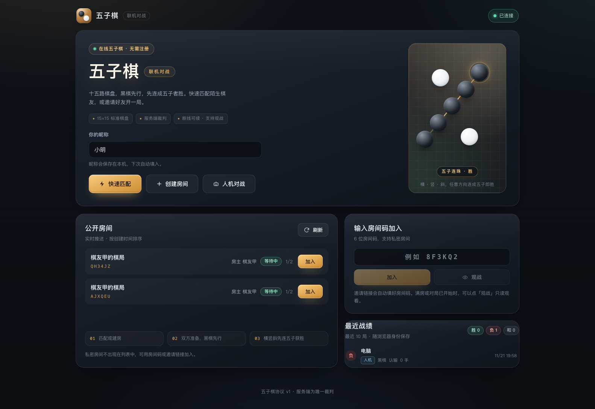

## 功能

| 模块 | 能力 |
| --- | --- |
| 首页 | 游戏中心：按「棋类对战 / 实时对战」分组展示全部游戏，含开发中游戏卡片 |
| 游戏 | 五子棋（15×15，五连获胜）；中国象棋（9×10，将死/困毙获胜）；坦克大战（96×96 地图，2–8 人实时 3D 自由混战，20Hz 服务端权威，见 [实现契约](docs/TANK.md)） |
| 联机 | 快速匹配、公开/私密房间、房间码与邀请链接、双方准备开局、观战（最多 20 人） |
| 房间设置 | 五子棋可选 9/11/13/15/17/19 路棋盘（手机小棋盘更快）；坦克大战房主可选 2/3/5/10 分钟时长，人机与再来一局沿用 |
| 身份 | 浏览器 localStorage 中的 UUID（首次访问由服务端生成，永不过期）；刷新/重开浏览器/换标签页可凭同一 UUID 恢复座位 |
| 对局 | 服务端走子校验、悔棋请求/回应、认输、再来一局（自动交换先后手）、断线宽限与弃权结算 |
| 玩法 | 内置电脑对手：五子棋启发式 AI；中国象棋 alpha-beta 搜索 AI；坦克大战 AI 电脑坦克（追击、绕障、提前量瞄准、按距离开火，可选 1–7 台 + 简单/普通/困难三档难度） |
| 体验 | 五子棋乐观落子 + 落子动画、涟漪、胜利连线；象棋选中/合法落点高亮、将军提示、上一步标记 |
| 音效 | WebAudio 实时合成：棋类落子/胜负/和棋；坦克大战引擎声（随车速变化）、炮声、命中、爆炸（按距离衰减）、装填提示，可随时静音并记住设置 |
| 战绩 | 每位玩家保留最近 10 局，标记游戏、模式、结果、手数；仅保存在服务端内存 |
| 渲染 | 棋类棋盘全部 **Canvas 2D**（离屏静态层 + 按需重绘 + DPR 自适应）；坦克大战 **three.js** 3D（懒加载 chunk）：程序化坦克/砖砌仓库/集装箱/沙袋/森林植被 + ACES 色调映射 + Bloom/色彩分级/抗锯齿后处理 + 动态阴影与大气雾，等距/追尾/全场三视角（滚轮缩放 + 障碍射线夹紧防穿模），对局时**全画布沉浸模式**（铺满窗口、隐藏站点页头页脚） |
| 协议 | 回合制 JSON（v2）；实时游戏 v3 二进制帧（文本帧 + 二进制帧同连接共存，前后端共享 golden fixture） |

### 前端路由

每个游戏有独立 URI 与源码目录，新增游戏不需要改 App/Lobby：

| URL | 页面 |
| --- | --- |
| `/` | 游戏中心首页（全部游戏、开发中游戏） |
| `/gomoku`、`/chess`、`/tank` | 对应游戏的大厅 |
| `/gomoku/room/ABC123` | 对局页 / 邀请链接（`{game}/room/{code}`，坦克为 `/tank/room/ABC123`） |
| `/room/ABC123` | 未指定游戏的通用房间入口，加入后规范为 `/{game}/room/{code}` |

旧版 `?game=chess`、`?room=ABC123` 链接仍可用，首帧会自动替换为上面的路径。

新增游戏：在 `web/src/games/<slug>/` 放 `meta.ts` + 棋盘组件，登记到 `registry.ts`，首页和路由自动生效。只是规划中的游戏放 `planned.ts`，不会污染协议 `GameType`。

### 五子棋 / 中国象棋截图

| 五子棋对局 | 中国象棋对局 |
| --- | --- |
|  | 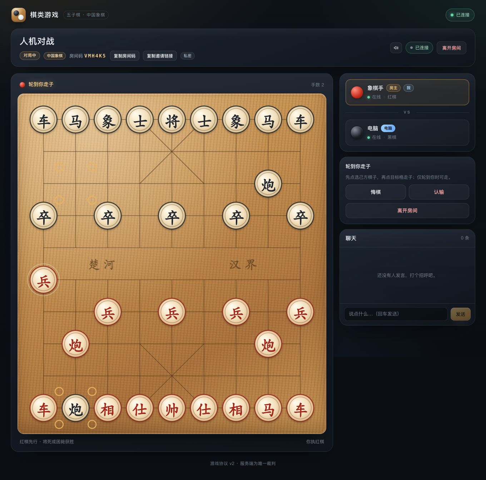 |

| 五子棋终局 | 移动端 |
| --- | --- |
| 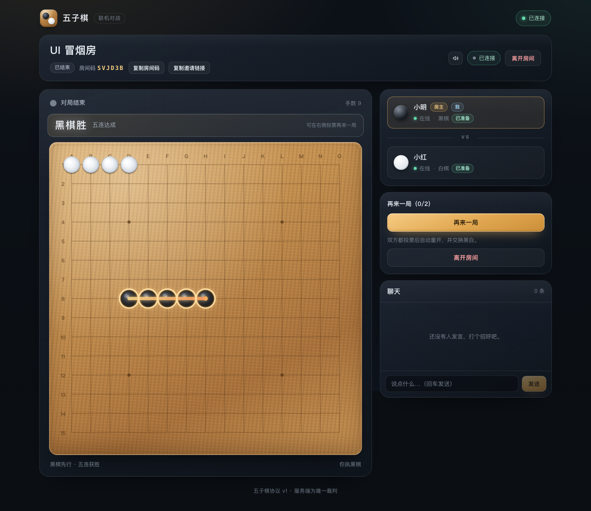 |  |

### 坦克大战截图

| 等待开局（2–8 人） | 等距对局视角（默认） |
| --- | --- |
| 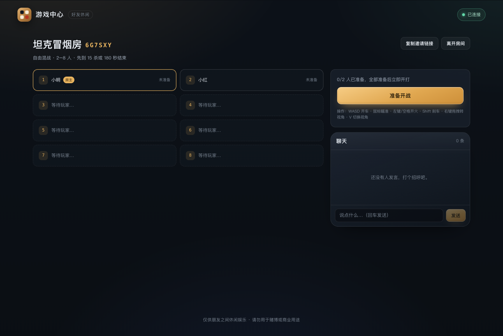 | 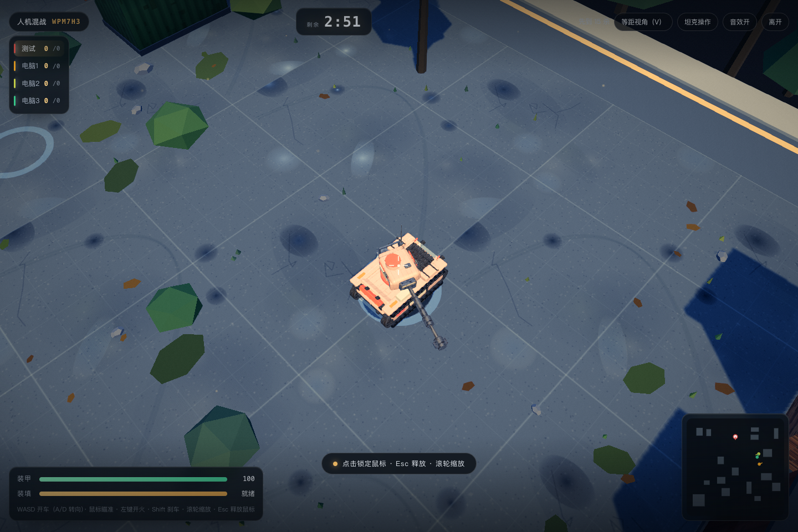 |

| 追尾视角 | 开火与爆炸特效 |
| --- | --- |
| 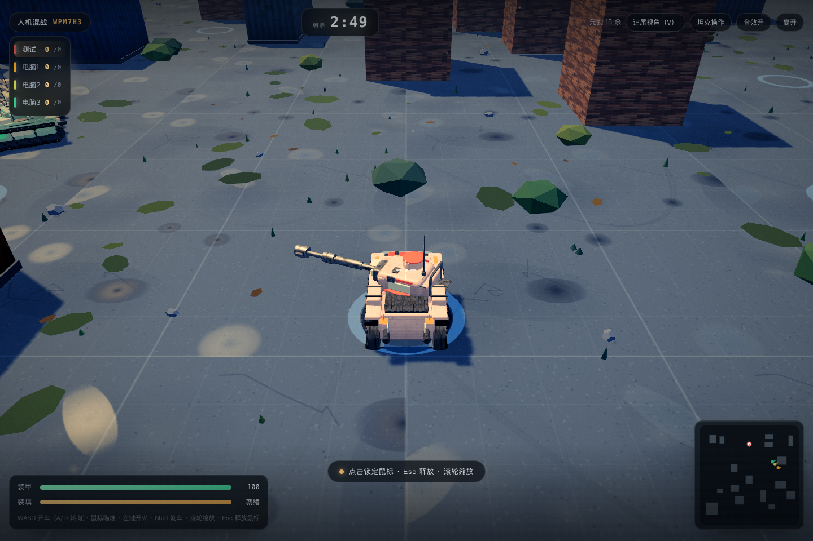 | 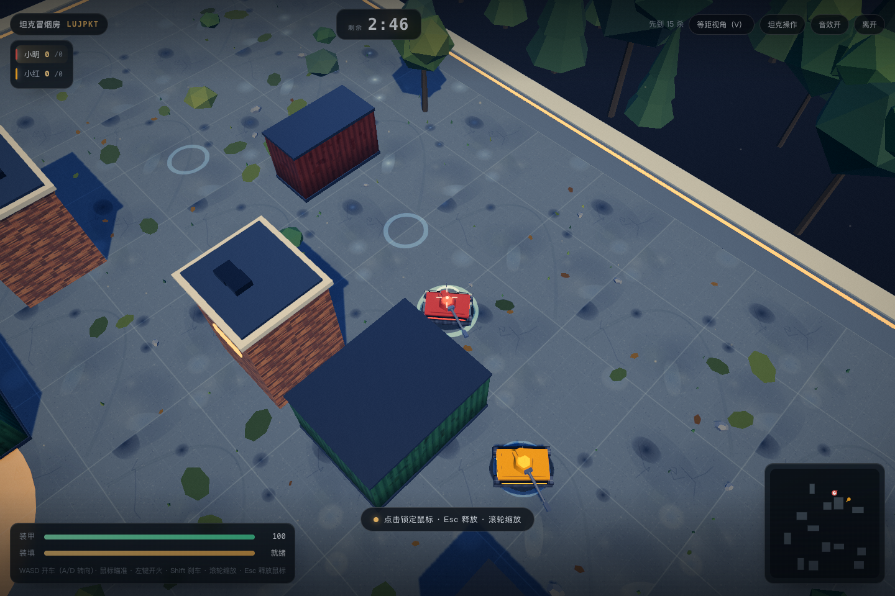 |

| 全场俯视 | 人机混战（1 人 + 3 台电脑） |
| --- | --- |
| 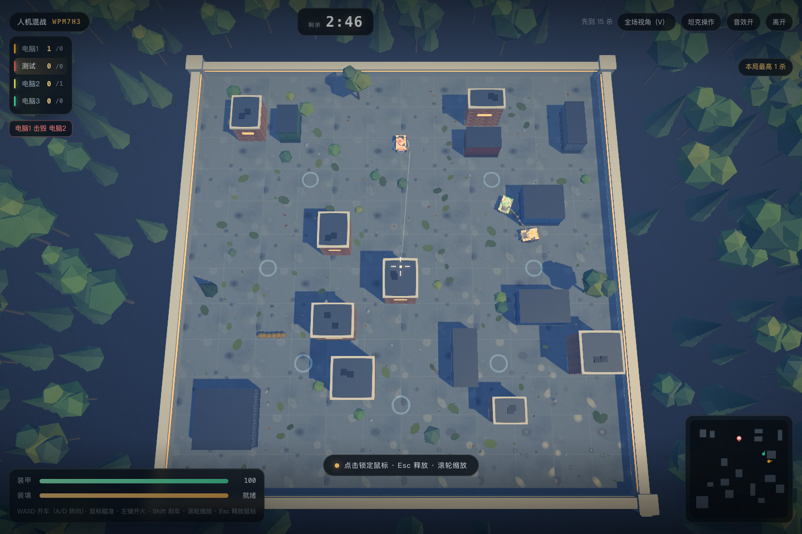 | 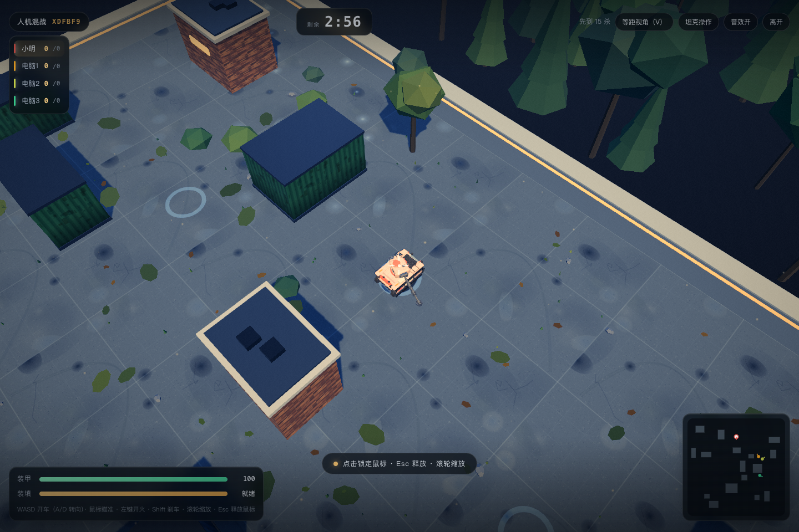 |

| 载具近景（技术插画风涂装） | 全场视角·名字标签与本地"你" |
| --- | --- |
| 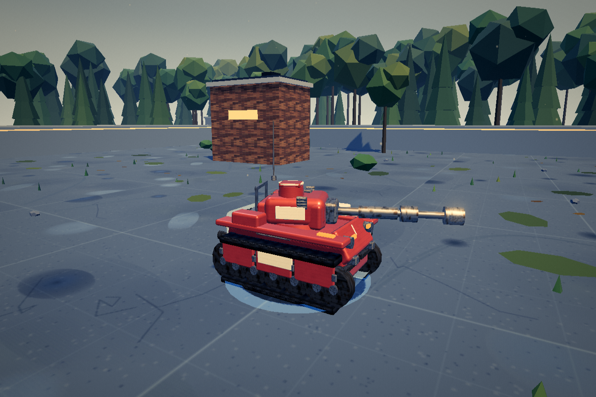 | 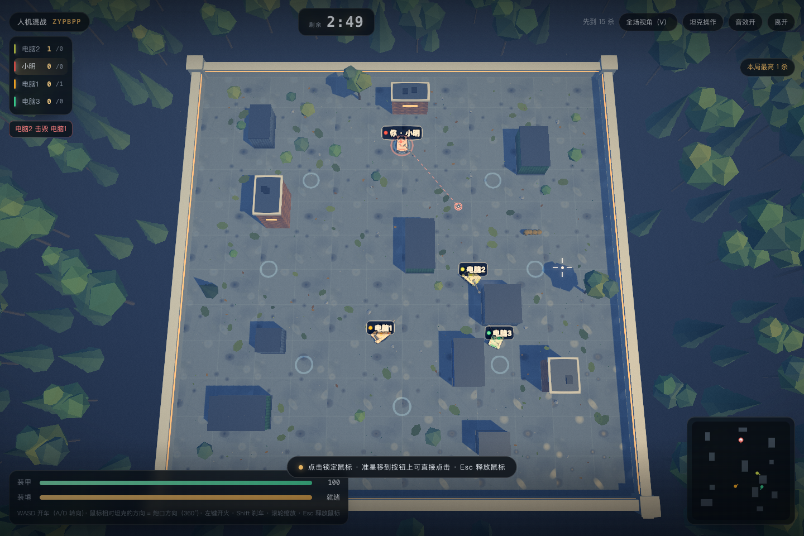 |

| 缩放贴墙不穿模 | 视角跟随鼠标（追尾） |
| --- | --- |
| 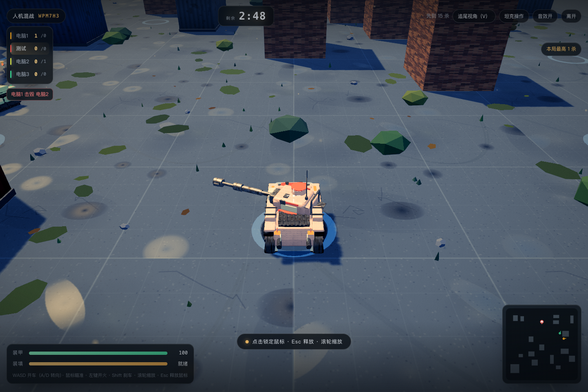 | 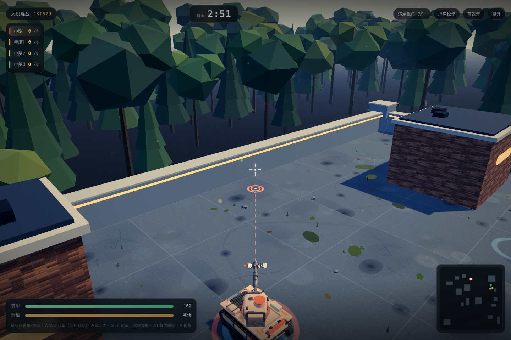 |

| 本局结算 |
| --- |
| 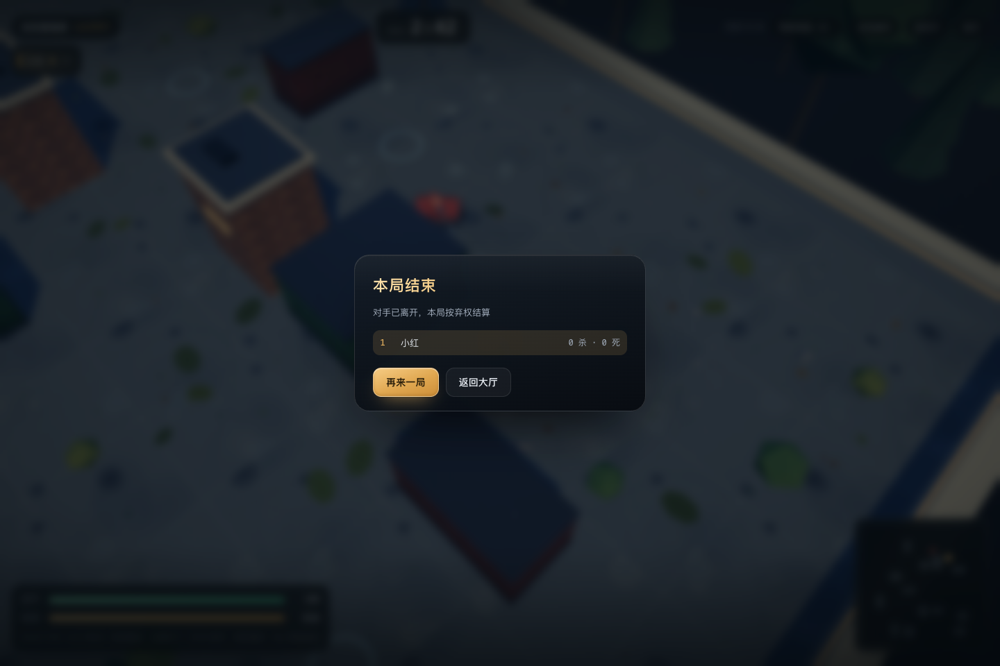 |

## 技术栈与目录

- 前端：React 18、TypeScript 5.6、Vite 5、纯 CSS（无 UI 组件库）；3D 坦克大战用 three.js（仅 `/tank` 路由动态 import，主包不受影响）
- 后端：Python 3.11、FastAPI、uvicorn、原生 WebSocket
- 部署：前端静态资源由 Nginx / CDN / Cloudflare Workers 托管；后端只提供 `/api` 与 `/ws`，**不托管任何前端文件**

```text
games/
├── server/
│   ├── app/
│   │   ├── main.py          # FastAPI：/api/health、/api/rooms、/api/config + WS
│   │   ├── ws.py            # WebSocket 接入、UUID 身份、消息分发
│   │   ├── rooms.py         # 游戏无关的房间生命周期 / 悔棋 / 认输 / AI / 战绩
│   │   ├── games/
│   │   │   ├── base.py      # GameRules 插件接口
│   │   │   ├── gomoku.py    # 五子棋规则
│   │   │   ├── chess.py     # 中国象棋规则 + AI
│   │   │   ├── tank.py      # 坦克大战纯模拟（移动/碰撞/命中/复活/胜负）
│   │   │   ├── tank_ai.py   # 电脑坦克决策（追击/绕障/提前量瞄准/开火）
│   │   │   └── tank_rules.py# 实时游戏的 GameRules 适配层
│   │   ├── realtime/
│   │   │   ├── codec.py     # 协议 v3 二进制帧编解码
│   │   │   └── engine.py    # 20Hz tick 循环 + 快照广播
│   │   ├── game.py / ai.py  # 五子棋棋盘算法与启发式 AI
│   │   └── protocol.py      # 协议 v2 常量、错误码、校验
│   ├── tests/               # pytest（规则 + 房间 + WebSocket 集成）
│   └── run.py               # CLI 启动入口（--host/--port/--reload）
├── web/
│   └── src/
│       ├── games/
│       │   ├── registry.ts       # 游戏注册表：新增游戏只改这里
│       │   ├── types.ts          # GameDefinition / GameListing
│       │   ├── planned.ts        # 开发中游戏占位（当前为空）
│       │   ├── gomoku/
│       │   │   ├── meta.ts       # /gomoku 的路由与文案
│       │   │   └── Board.tsx     # 五子棋 Canvas 棋盘
│       │   ├── chess/
│       │   │   ├── meta.ts       # /chess 的路由与文案
│       │   │   └── ChessBoard.tsx
│       │   └── tank/             # 坦克大战：协议 / 输入 / 插值 / 3D 渲染 / HUD
│       │       ├── meta.ts
│       │       ├── protocol.ts   # 二进制帧 → 实体
│       │       ├── net.ts        # 快照缓冲、插值、外推、平滑
│       │       ├── input.ts      # 键盘 + 鼠标输入位
│       │       ├── scene.ts      # three.js 场景（懒加载）
│       │       ├── TankRoom.tsx  # 对局页（等待/战斗/结算）
│       │       └── TankHud.tsx   # 比分榜、血量、小地图、播报
│       ├── components/
│       │   ├── Home.tsx          # 游戏中心首页
│       │   ├── Lobby.tsx         # 大厅（游戏切换跳 URI）
│       │   ├── RoomView.tsx      # 通用对局页
│       │   └── ...
│       ├── hooks/useGameSocket.ts# WS 状态机 + 动作
│       ├── lib/router.ts         # /{game}、/{game}/room/{code} 路径路由
│       ├── lib/realtime/codec.ts # 协议 v3 二进制帧编解码 + vitest
│       ├── lib/protocol.ts       # 运行时协议解析
│       └── types.ts              # 多游戏类型
├── deploy/nginx.container.conf
├── Dockerfile / Dockerfile.web / docker-compose.yml
├── PROTOCOL.md                  # 协议 v2（含两种 game 状态）
├── docs/TANK.md                 # 坦克大战实现契约（帧格式、常量、接口）
├── shared/realtime-v3.fixtures.json # 前后端共享二进制黄金样例
├── docs/REALTIME.md             # 实时游戏 tick / 二进制 WS 设计与落地状态
└── scripts/                     # start/dev/e2e/ui_smoke + gen_realtime_fixtures
```

## 快速开始（开发模式）

```bash
# 后端（仓库根目录）
./scripts/dev.sh              # uvicorn 热重载，默认 127.0.0.1:8765

# 前端（另开终端）
cd web
npm install
npm run dev                   # http://127.0.0.1:5173
npm test                      # v3 二进制编解码单测（与后端共享 fixture）
```

Vite 已把 `/api` 与 `/ws` 代理到 `http://127.0.0.1:8765`；也可以用 `DEV_BACKEND=http://host:port npm run dev` 指定其他后端。

### 手动启动

```bash
python3 -m venv server/.venv && server/.venv/bin/pip install -r server/requirements.txt
cd server && .venv/bin/python run.py --host 0.0.0.0 --port 8765 --reload

cd web && npm run dev
```

> 监听地址/端口只由启动参数决定，不从 `.env` 读取端口；应用配置从仓库根 `.env` 或 `server/.env` 读取。

## 生产部署（前端静态资源 + 后端 API/WS）

前端与后端分开部署，后端**不提供静态文件**。

```bash
# 1) 构建前端（构建期注入部署地址）
cd web
VITE_BASE_PATH=/games/ \
VITE_API_BASE=https://cloudflare.org.cn/games \
VITE_WS_URL=wss://cloudflare.org.cn/games/ws \
npm run build

# 2) 启动后端
cd ..
./scripts/start.sh --host 127.0.0.1 --port 8765
```

把 `web/dist` 部署到 `https://example.com/games/`；Nginx 参考：

```nginx
location /games/ {
    alias /www/wwwroot/games/web/dist/;
    index index.html;
    try_files $uri $uri/ /games/index.html;
    location = /games/index.html { add_header Cache-Control "no-cache"; }
    location ~* ^/games/assets/ {
        add_header Cache-Control "public, max-age=31536000, immutable";
    }
}

# REST：/games/api/* → 后端 /api/*
location /games/api/ {
    proxy_pass http://127.0.0.1:8765/api/;
    proxy_set_header Host $host;
    proxy_set_header X-Real-IP $remote_addr;
    proxy_set_header X-Forwarded-For $proxy_add_x_forwarded_for;
    proxy_set_header X-Forwarded-Proto $scheme;
}

# WebSocket：/games/ws → 后端 /ws
location = /games/ws {
    proxy_pass http://127.0.0.1:8765/ws;
    proxy_http_version 1.1;
    proxy_set_header Upgrade $http_upgrade;
    proxy_set_header Connection "upgrade";
    proxy_set_header Host $host;
    proxy_read_timeout 3600s;
}
```

### systemd

```ini
# /etc/systemd/system/games-api.service
[Unit]
Description=Games API/WS (Gomoku + Chinese Chess)
After=network.target

[Service]
WorkingDirectory=/www/wwwroot/games
EnvironmentFile=/www/wwwroot/games/.env
ExecStart=/www/wwwroot/games/server/.venv/bin/python server/run.py --host 127.0.0.1 --port 8765
Restart=on-failure
RestartSec=3

[Install]
WantedBy=multi-user.target
```

```bash
sudo systemctl daemon-reload
sudo systemctl enable --now games-api
```

### Docker

```bash
docker compose up -d --build
# 前端 http://localhost:8080，Nginx 容器内把 /api、/ws 反代到 api 容器
```

### Cloudflare Workers（前端静态资源）

线上 Worker `games` 绑定自定义域 `https://games.later.design/`，部署在域名**根路径**，因此构建时 `VITE_BASE_PATH=/`。

`web/wrangler.jsonc` 已配置 `assets.directory = "./dist"` 与 SPA 回退（`/{game}/room/{code}` 刷新时回落到 `index.html`）。部署务必使用构建产物：

```bash
cd web
npm run deploy        # = npm run build && wrangler deploy，上传的是 dist/
```

#### Cloudflare 构建配置（Workers Builds / Pages）

仓库里 **`web/dist` 是构建产物、不进 git**（`web/.gitignore` 里忽略），所以 CI 必须先构建再 deploy。
如果 CI 日志出现：

```
✘ [ERROR] The directory specified by the "assets.directory" field ... does not exist:
  /opt/buildhome/repo/web/dist
```

说明只执行了 `npx wrangler deploy`、没有执行构建。在 Cloudflare 项目 → Settings → Build 里按下表配置（二选一）：

| 配置项 | 方案 A（推荐） | 方案 B |
| --- | --- | --- |
| Root directory | `web` | `web` |
| Build command | `npm run build` | *(留空)* |
| Deploy command | `npx wrangler deploy` | `npm run deploy` |

方案 B 的 `npm run deploy` 自带构建（`= npm run build && wrangler deploy`），即使 Build command 留空也不会缺 `dist/`。
无论哪种，构建产物都必须在 wrangler 之前生成；本地手动部署同样用 `npm run deploy`。

> ⚠️ 不要直接把 `web/` 源码目录当静态资源上传：HTML 里的 `/src/main.tsx` 没有 MIME，
> 浏览器会报 “Expected a JavaScript-or-Wasm module script…”，页面纯黑。
> 若前端改部署到子路径（如 `https://cloudflare.org.cn/games/`），构建时设 `VITE_BASE_PATH=/games/` 并重新构建。

### 前后端分域部署

同域部署无需 CORS；分域时配置后端 `CORS_ORIGINS=https://your-frontend.example.com`（当前前端是 `https://games.later.design`，后端是 `https://cloudflare.org.cn/games`，需要把前者加入 CORS），前端通过 `VITE_API_BASE` / `VITE_WS_URL` 指到后端域名。身份保存在前端 localStorage 的 UUID 中，不依赖 Cookie，因此前后端跨域部署不受第三方 Cookie 限制；后端需在 `ALLOWED_ORIGINS` 中放行前端域名。

## 环境变量

### 后端（`server/.env` 或仓库根 `.env`）

| 变量 | 默认 | 说明 |
| --- | --- | --- |
| `BOARD_SIZE` | `15` | 五子棋棋盘路数（5–25） |
| `CORS_ORIGINS` | 本地 5173 | 允许跨域的前端 Origin，逗号分隔 |
| `ALLOWED_ORIGINS` | 空 | 额外允许的 Origin（可选） |
| `ROOM_TTL_SECONDS` | `21600` | 空 waiting 房间回收时间；`0` 关闭 |
| `DISCONNECT_GRACE_SECONDS` | `60` | 掉线宽限，超时按弃权结算 |
| `HOST` / `PORT` | — | 不使用；监听地址只由 `run.py --host/--port` 决定 |

### 前端（Vite 构建期变量）

| 变量 | 默认 | 说明 |
| --- | --- | --- |
| `VITE_BASE_PATH` | `/` | 子路径部署，如 `/games/` |
| `VITE_API_BASE` | 空（同源） | REST 基础地址，如 `https://cloudflare.org.cn/games` |
| `VITE_WS_URL` | 同源 `/ws` | WebSocket 完整地址，如 `wss://cloudflare.org.cn/games/ws` |

本地覆盖推荐写在 `web/.env.production.local`（已被 `.gitignore` 忽略）。

## 测试

```bash
# 1) 后端规则 + 房间 + WebSocket 集成（当前 122 个用例）
server/.venv/bin/python -m pytest -q server/tests

# 2) 端到端（需先启动后端）
server/.venv/bin/python scripts/e2e.py --url http://127.0.0.1:8765

# 3) 前端类型检查 + 生产构建
cd web && npx tsc --noEmit && npm run build
```

UI 冒烟（Playwright，可选）：

```bash
./scripts/start.sh
cd web && npm run dev          # 或 npm run build && npm run preview
/tmp/pwenv/bin/python scripts/ui_smoke.py --url http://127.0.0.1:5173
```

覆盖：五子棋建房/邀请/准备/五连/再来一局/聊天/观战/刷新与 UUID 身份恢复，以及中国象棋游戏切换/人机开局/红兵前进/电脑应手。

坦克大战 3D 冒烟（同样可选）：

```bash
./scripts/start.sh
cd web && npm run dev
/tmp/pwenv/bin/python scripts/tank_smoke.py --url http://127.0.0.1:5173
```

覆盖：/tank 大厅 → 建房 → 邀请链接加入 → 双方准备 → 3D 战场与 HUD 渲染 → 全画布铺满窗口（页头页脚隐藏）→ 服务端 tick 倒计时 → 指针锁定/释放与准星 → WASD/鼠标/开火 → 屏幕四角瞄准角非空且互不相同（鼠标瞄准回归）→ 爆炸特效与 Bloom → 音效开关 → V 三态视角 → C 切换操作方案 → 离开结算 → 人机混战（1 人 + 3 台电脑立即开局、离开解散），并断言无控制台报错。

## REST / 协议

- `GET /api/health` → `{status,version,uptimeSeconds,rooms,connections,serverTime}`
- `GET /api/rooms?game=gomoku|chess` → `{rooms:[{id,name,gameType,status,playerCount,maxPlayers,hostName,createdAt}]}`
- `GET /api/config` → 协议版本、五子棋路数、游戏列表（名称/颜色）
- `GET /ws` → WebSocket（控制面 JSON v2 + 实时游戏二进制 v3 帧，详见 [`PROTOCOL.md`](PROTOCOL.md)、[`docs/TANK.md`](docs/TANK.md)）

`welcome` 新增能力字段 `binary: true`、`tickRate: 20`；实时房间的输入/快照走二进制帧，
文本帧与二进制帧在同一条连接上混用，大厅与棋类协议完全不变。

## 设计与实现要点

- **多游戏插件化**：`server/app/games/base.py` 定义 `GameRules`（开局/走子/悔棋/AI/终局/合法走法），`rooms.py` 只处理玩家、准备、悔棋、认输、观战、AI 调度、战绩与广播；新增游戏只需实现规则并注册。
- **服务端权威**：所有走法与胜负由 Python 规则引擎计算；前端不做规则判断，只根据快照与 `legalMoves` 展示。
- **五子棋**：15×15 棋盘，黑白轮流，横/竖/斜先成五者胜；悔棋 AI 自动同意并回退双方最近两步。
- **中国象棋**：完整走子规则（马腿、象眼、炮架、九宫、过河兵、将帅照面、不能送将），将军/将死/困毙判定；AI 使用 alpha-beta + 子力评估（带时间/节点上限）。
- **五子棋 AI**：启发式形状评分，只搜索已有棋子附近候选点，低延迟。
- **身份与重连**：首次连接时服务端生成 UUID v4，前端存入 localStorage（永不过期），之后每次连接通过 `?uid=<uuid>` 带回；多标签页共享同一身份，不互踢。
- **渲染**：棋盘 Canvas 2D，静态网格离屏缓存，棋子/提示按需重绘；五子棋落子动画走 `requestAnimationFrame`，空闲停帧；象棋选中/合法点/将军/上一步全部在 Canvas 绘制。
- **音效**：WebAudio 合成，无音频资源；`games.sound.enabled.v1` 持久化静音状态。
- **实时游戏（坦克大战）**：服务端 `TankWorld` 纯模拟 + `TankSession` 20Hz tick（累计器补帧，单帧最多追 5 步），每 tick 编码关键帧广播；客户端只发输入意图，位置/碰撞/命中全部由服务端计算，前端按 100ms 缓冲插值 + 速度外推 + 指数平滑渲染。
- **3D 渲染**：three.js 懒加载（`/tank` 路由才 import，独立 chunk），程序化砖砌仓库/集装箱/沙袋与锥形针叶树/圆冠阔叶树、外围森林 + 场内草丛/灌木/碎石（InstancedMesh 合并 drawcall，不参与碰撞），等距/追尾/全场三视角（V 循环），炮塔跟随鼠标即时转向（视觉），地面有贴地瞄准环与辅助线。
- **载具模型**：单辆约 10 个 Mesh / 7.5k 三角面（按材质合并几何，全场 8 辆 + 环境 + 后处理约 126 drawcall）；倒角车体与炮塔、5 负重轮 + 主动轮 + 每侧 22 段履带链节、车长塔/潜望镜/舱盖/尾舱架/烟雾弹发射器/细电缆等细节；涂装为「队伍色与米白混合漆面 + 高饱和队伍色点缀 + 程序化面板缝/铆钉/掉漆/尘土」，漆面 clearcoat + roughnessMap。
- **操作方案（商业坦克手感）**：点画面锁定鼠标后，**鼠标移动准星**（准星/标靶跟随鼠标，标靶距离随准星位置变化，实测 6–43 米）；**炮塔指向准星正下方的地面点（360° 无限制），炮管随距离做视觉俯仰**；**车体只由 A/D 控制转向（不会跟着鼠标自转）**，W/S 前进倒车；相机自动跟在车体后方（视角跟随车体）；C 切换 坦克式/街机式；准星移到 HUD 按钮可直接点击，Alt 释放鼠标；滚轮缩放、V 切追尾/等距/全场。
- **名字标签**：每辆坦克头顶显示「队伍色圆点 + 昵称」，本地为「你 · 昵称」；无底板、文字描边保证可读，宽度按文字自适应、屏幕恒定尺寸。
- **瞄准与受击反馈**：标靶环画在准星正下方的地面交点（距离随准星位置变化、置顶不被掩体遮挡）；被命中时屏幕红闪 + 屏震 + 掉血数字（-25）+ 命中音效，被击毁有火球爆炸/碎片/烟柱/地面焦痕；命中墙体/集装箱/沙袋会留下贴合表面的持久弹坑与烧蚀痕；坦克头顶名字标签、本地"你 · 昵称"、脚下脉冲环。
- **打击特效**：子弹命中墙体/集装箱/沙袋按材质产生砖屑/火花/沙粒 + 贴合表面的弹坑/烧蚀/焦痕贴花（池化 1 drawcall、容量 256；墙面弹痕保留 240–300 秒）；坦克移动留下两条缓慢淡出的履带印（≤200 段、1 drawcall）；砖墙有砖色差异/灰缝/裂纹/水渍/喷涂编号，集装箱有门锁杆/角件/贴纸/通风口/锈斑，边界墙内侧有管线灯带与压顶石。
- **指针锁定下的 HUD 操作**：准星就是虚拟光标，移到 HUD 按钮上高亮、左键直接点（开火/音效/视角/离开都无需先按 Esc 释放鼠标）。
- **瞄准共线模型**：准星射线打中地面时，炮塔 yaw 直接指向该地面点，炮管再按距离做视觉俯仰，使「炮管 → 虚线 → 标靶环」在屏幕上是一条直线；准星指向天空/地平线（射线打不到地面）时退回「准星 NDC − 本地坦克 NDC」的屏幕方向模型，仍支持任意角度、当前帧直接生效。
- **驾驶可选**：**坦克式**（WASD 前后 + A/D 原地转向，默认）或**街机式**（WASD 按屏幕方向移动、车体自动转向），C 键切换并 localStorage 记忆。
- **色彩管线**：ACESFilmic 色调映射 + sRGB 输出、程序化黄昏 PMREM 环境贴图、EffectComposer（Bloom + SMAA + 自写色彩分级/暗角/颗粒）、渐变天空穹顶 + FogExp2、PCFSoft 阴影与坦克接触阴影；帧耗时超过阈值 2 秒会自动降级（关 Bloom、降阴影分辨率），接口不变。
- **音效**：坦克大战用独立 WebAudio 合成图（引擎连续音随车速变化、炮声/命中/爆炸按距离衰减），与棋类共用静音开关。
- **坦克 AI**：`server/app/games/tank_ai.py` 每 tick 读世界快照输出一帧输入，与真人共用同一套物理/碰撞/冷却规则（服务端权威、无作弊）；行为包含目标选择、绕障与倒车脱困、按子弹飞行时间的提前量瞄准、视线遮挡判定与反应延迟。难度档位 `easy/normal/hard` 只调整瞄准误差、反应延迟、跟瞄速度、开火精度等参数（`PROFILES`）。人机房 `mode=ai` + `botCount=1–7` + `botDifficulty`，建房即开局，最后一名真人离开即解散。

## 已知边界

- 房间、战绩、身份均保存在**服务端内存**，重启后丢失；水平扩展需要 Redis/DB。
- 中国象棋暂未实现长将判负、重复局面判和（仅有 240 半回合自然限着和棋）。
- 观战为只读实时快照，不支持聊天历史回放之外的复盘/棋谱导出。
- 坦克大战 v1 只有自由混战：无队伍、无道具、无人机；AOI/增量快照/本地预测校正暂未实现，观战 5Hz、玩家 20Hz。
- 房间码为 6 位、房间列表按创建时间排序；大规模公开房间需要分页与检索。
- UUID 即身份凭证：拿到 UUID 的人可以冒充该玩家。它只适合朋友间休闲娱乐，不应在公开场合暴露；清除 localStorage 会得到全新身份。
