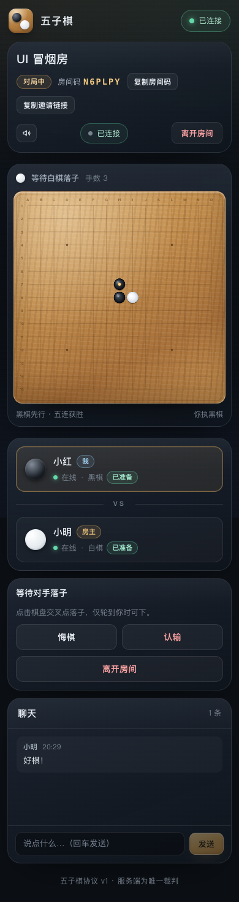

# 五子棋 · 联机对战（React + TypeScript / Python）

一个可以直接放到公网联机的五子棋小游戏：**前端 React 18 + TypeScript + Vite**，
**后端 Python 3.11 + FastAPI + WebSocket**。服务端为唯一裁判，房间码邀请、
快速匹配、准备开局、聊天、再来一局、断线重连全部可用。

- **前后端职责分离**：Python 后端只提供 `/api` 与 `/ws`，不读写任何前端文件；
  前端构建产物 `web/dist` 由 Nginx / CDN 托管（开发用 Vite）。后端进程不包含 Node、
  不构建前端，也不做静态文件兜底。
- 单进程内存房间，零数据库，零 Redis，部署成本极低。
- 协议契约见 [`PROTOCOL.md`](./PROTOCOL.md)，前后端都按它实现。

```
浏览器 ──静态资源──► Nginx / CDN（web/dist）
   └──── /api、/ws ──► FastAPI (8765) ──► 房间内存状态
```

## 获取代码

```bash
git clone https://github.com/laterinc/gomoku.git
cd gomoku
```

## 功能

| 模块 | 能力 |
| --- | --- |
| 大厅 | 修改昵称、快速匹配、创建房间（公开/私密、执黑/执白/随机）、公开房间列表、房间码加入、`?room=CODE` 邀请链接 |
| 对局 | 15 路棋盘、黑白轮流、服务端判胜（横/竖/斜，≥5 连）、和棋、最后一手标记、胜利连线高亮、手数、双方在线状态 |
| 房间 | 双方准备开局、房主标识、复制房间码/邀请链接、离开房间、对手离开判负并重置等待新对手 |
| 社交 | 房间内聊天（保留最近 50 条、长度限制、频率限制） |
| 稳定性 | 断线自动重连、会话恢复（playerId + token）、掉线 60s 宽限、心跳保活、消息限流 |

## 界面预览

| 大厅 | 对局中 |
| --- | --- |
|  |  |

| 五连复盘 | 移动端 |
| --- | --- |
|  |  |

## 目录

```
gomoku/
├── PROTOCOL.md          # 前后端 WebSocket 协议契约（唯一事实源）
├── README.md
├── Dockerfile           # 后端镜像（Python / uvicorn，只跑 API/WS）
├── Dockerfile.web       # 前端镜像（Node 构建 → Nginx 托管 dist）
├── deploy/nginx.container.conf  # 容器内 Nginx 配置（/api、/ws 反代）
├── docker-compose.yml   # api + web 两个容器
├── .env.example
├── docs/screenshots/    # 界面截图（README 预览用）
├── scripts/
│   ├── dev.sh           # 开发：后端 8765 + Vite 5173
│   ├── start.sh         # 生产：只启动后端 API/WS
│   ├── e2e.py           # 端到端联机冒烟（真实 WebSocket 双人对局）
│   └── ui_smoke.py      # 浏览器 UI 冒烟（可选，Playwright + 本机 Chrome）
├── server/              # Python 后端（无静态文件服务）
│   ├── app/             # main / config / game / rooms / ws ...
│   ├── tests/           # pytest：规则 + 房间 + WebSocket 全流程
│   └── requirements.txt
└── web/                 # React + TS 前端（独立构建、独立部署）
    ├── src/
    └── vite.config.ts
```

## 快速开始（开发模式）

环境：Node.js ≥ 18、Python ≥ 3.11。

```bash
# 在仓库根目录（gomoku/）执行
./scripts/dev.sh
```

- 前端：<http://localhost:5173>（Vite HMR，`/api` 与 `/ws` 代理到后端）
- 后端：<http://127.0.0.1:8765>（`/api/health` 可探活）

> 如果 `.env` 里改了 `PORT`（例如 8281），Vite 代理也要跟着指过去：
> 在 `web/.env.development` 里设置 `DEV_BACKEND=http://127.0.0.1:8281`。

首次运行脚本会自动 `python3 -m venv server/.venv`、安装依赖、`npm install`。

### 手动启动

```bash
# 后端（推荐：自动读取 .env 里的 HOST/PORT）
cd server
python3 -m venv .venv
.venv/bin/pip install -r requirements.txt
cp .env.example .env        # 按需修改 HOST / PORT
.venv/bin/python run.py     # 开发可加 --reload

# 前端（另开终端）
cd web
npm install
npm run dev
```

## 生产部署（前端 Nginx/CDN + 后端 API/WS）

后端**只提供 `/api` 与 `/ws`**，不托管静态文件。生产环境用 Nginx（或 CDN）托管
`web/dist`，并把 `/api`、`/ws` 反代到后端进程。

```bash
# 1) 构建前端（本地/CI 均可）
cd web && npm ci && npm run build        # 产物：web/dist

# 2) 后端（仓库根目录）
cd ..
cp server/.env.example server/.env       # 默认 HOST=127.0.0.1 PORT=8000
./scripts/start.sh                       # 只启动 API/WS

# 3) 把 web/dist 上传到服务器，例如 /www/wwwroot/gomoku/web/dist
```

Nginx 示例（前端与后端同域，无需 CORS）：

```nginx
server {
    listen 443 ssl http2;
    server_name gomoku.example.com;

    root  /www/wwwroot/gomoku/web/dist;
    index index.html;

    # 前端 SPA：静态文件直出，未知路径回 index.html
    location / {
        try_files $uri $uri/ /index.html;
        add_header Cache-Control "no-cache" always;
    }
    location /assets/ {
        add_header Cache-Control "public, max-age=31536000, immutable";
    }

    # REST
    location /api/ {
        proxy_pass         http://127.0.0.1:8000;
        proxy_http_version 1.1;
        proxy_set_header   Host              $host;
        proxy_set_header   X-Real-IP         $remote_addr;
        proxy_set_header   X-Forwarded-For   $proxy_add_x_forwarded_for;
        proxy_set_header   X-Forwarded-Proto $scheme;
    }

    # WebSocket（必须带 Upgrade/Connection 头）
    location /ws {
        proxy_pass         http://127.0.0.1:8000;
        proxy_http_version 1.1;
        proxy_set_header   Upgrade    $http_upgrade;
        proxy_set_header   Connection "upgrade";
        proxy_set_header   Host       $host;
        proxy_read_timeout 3600s;
    }
}
```

证书：`sudo certbot --nginx -d gomoku.example.com`。

后端 systemd（单进程，只跑 API/WS）：

```ini
# /etc/systemd/system/gomoku-api.service
[Unit]
Description=Gomoku API/WS
After=network.target

[Service]
WorkingDirectory=/opt/gomoku/server
Environment=HOST=127.0.0.1
Environment=PORT=8000
# 端口读取 server/.env（也可保留上面的 Environment= 覆盖）
ExecStart=/opt/gomoku/server/.venv/bin/python /opt/gomoku/server/run.py
Restart=always

[Install]
WantedBy=multi-user.target
```

> ⚠️ 房间状态在进程内存中，**只能跑 1 个 worker / 1 个实例**；
> 需要水平扩展时把房间状态换成 Redis 再谈多实例。

### 本地验证生产形态

```bash
./scripts/start.sh                              # 终端 A：后端 8765
cd web && npm run build && npm run preview      # 终端 B：4173（preview 代理 /api、/ws）
# 打开 http://localhost:4173
```

Vite preview 的代理配置在 `web/vite.config.ts` 的 `preview.proxy`。
注意：preview 用的是**构建时**注入的地址——如果本机存在
`web/.env.production.local`（真实域名），本地 preview 会去连线上后端；
只做本地验证时请临时移开该文件或改用 `./scripts/dev.sh`。

### 局域网 / 公网隧道（临时联调）

```bash
./scripts/dev.sh                                # 5173 前端 + 8765 后端
cloudflared tunnel --url http://localhost:5173  # 或 ngrok http 5173
```

长期公网请用上面的 Nginx + 域名 + HTTPS。

### 前后端分域部署（可选）

前端在 Vercel/Netlify/CDN、后端在独立域名时：

- 后端设置 `CORS_ORIGINS=https://前端域名`，建议同时设置
  `ALLOWED_ORIGINS=https://前端域名`（WS 握手校验）；
- 前端构建时注入 `VITE_API_BASE=https://api.example.com`（会自动推导 WS 地址），
  或显式 `VITE_WS_URL=wss://api.example.com/ws`，见「前端环境变量」一节。

如果站点是**子路径**部署（例如 `https://example.com/gomoku/`），还需要：

```bash
# web/.env.production.local
VITE_BASE_PATH=/gomoku/
VITE_API_BASE=https://example.com/gomoku      # 不带末尾 /api
VITE_WS_URL=wss://example.com/gomoku/ws
```

```nginx
# Nginx 对应配置（注意 location 末尾的 /）
location /gomoku/ {
    alias /www/wwwroot/gomoku/web/dist/;
    try_files $uri $uri/ /gomoku/index.html;
}
location /gomoku/api/ { proxy_pass http://127.0.0.1:8000/api/; ... }
location /gomoku/ws   {
    proxy_pass http://127.0.0.1:8000/ws;
    proxy_http_version 1.1;
    proxy_set_header Upgrade $http_upgrade;
    proxy_set_header Connection "upgrade";
}
```

### Docker

`docker compose up -d --build` 构建两个容器：

| 服务 | 内容 | 端口 |
| --- | --- | --- |
| `api` | Python 后端，只跑 uvicorn（无静态文件） | 内部 8765 |
| `web` | Nginx + `web/dist`，`/api` `/ws` 反代到 `api` | 宿主 `8080:80` |

打开 `http://<服务器>:8080`。分域构建可传 `--build-arg VITE_API_BASE=...`
（见 `Dockerfile.web`），`docker-compose.yml` 也已透传。

> 后端镜像不包含 Node，也不构建前端；前后端可独立构建、独立部署。

### Cloudflare Workers（前端静态资源）

仓库内 `web/wrangler.jsonc` 已按「静态资源模式」配置：`web/dist` 直接作为 Worker
assets，SPA 路由由 `not_found_handling: single-page-application` 兜底。
Workers Builds 建议设置：

| 配置项 | 值 |
| --- | --- |
| Root directory | `web` |
| Build command | `npm run build` |
| Deploy command | `npx wrangler deploy` |
| Node version | `22`（`web/.nvmrc` 已指定，`package.json` engines `>=20`） |

构建环境变量（Cloudflare 项目 Settings → Variables and Secrets，勾选 Build）：

```ini
VITE_BASE_PATH=/                      # Worker 部署在域名根时
VITE_API_BASE=https://<后端域名>       # 不含末尾 /api
VITE_WS_URL=wss://<后端域名>/ws
```

注意事项：

- Worker 只托管静态资源，**不会**把 `/api`、`/ws` 代理到 Python；必须通过上面的
  `VITE_API_BASE` / `VITE_WS_URL` 指到后端；
- 后端需要允许 Worker 域名：`CORS_ORIGINS=https://<worker域名>`、
  `ALLOWED_ORIGINS=https://<worker域名>`；WebSocket 必须用 `wss://`；
- 若前端部署在**子路径**（如 `https://example.com/gomoku/`），把
  `VITE_BASE_PATH` 设为 `/gomoku/`，并相应调整 `VITE_API_BASE` / `VITE_WS_URL`；
- **改了 `package.json` 的依赖必须同步提交 `package-lock.json`**：Workers 用
  `npm ci` 安装，锁文件不同步会直接报
  `EUSAGE ... Missing: xxx from lock file`。改完执行
  `cd web && npm install && git add package-lock.json package.json`。
  仓库已加 GitHub Actions（`.github/workflows/web-ci.yml`）提前检查锁文件与构建。

## 配置（环境变量）

后端变量：复制 `.env.example` 为 `.env`（`python run.py` / `scripts/start.sh` 会读取；Docker 用 compose 的 `environment`）。
**所有变量都可不设，默认值即可跑。**

> ⚠️ **`uvicorn app.main:app` 不会读取 `.env` 里的 `HOST`/`PORT`。**
> `--host/--port` 是 uvicorn CLI 参数（默认 `127.0.0.1:8000`），`--env-file .env` 只是把变量
> 注入应用进程，并不会改变监听端口——所以 `.env` 写 `PORT=8281`、启动后仍是 8000。
> 需要 `.env` 生效请用 `python run.py`（或 `scripts/start.sh` / `scripts/dev.sh`）；
> 坚持用 uvicorn CLI 时把地址显式写全：
> `uvicorn app.main:app --host 127.0.0.1 --port 8281 --env-file .env`。

| 变量 | 默认 | 说明 |
| --- | --- | --- |
| `HOST` | `0.0.0.0` | 监听地址（由 `run.py` / 脚本读取；uvicorn CLI 需 `--host`） |
| `PORT` | `8765` | 监听端口（由 `run.py` / 脚本读取；uvicorn CLI 需 `--port`） |
| `BOARD_SIZE` | `15` | 棋盘路数（同时下发前端） |
| `CORS_ORIGINS` | `http://localhost:5173,http://127.0.0.1:5173` | REST 允许跨域来源，逗号分隔；同源部署可不管 |
| `ALLOWED_ORIGINS` | 空（放行） | WS 握手 Origin 白名单，公网建议设为你的域名 |
| `ROOM_TTL_SECONDS` | `21600` | waiting 房间空闲回收时间（6 小时） |
| `DISCONNECT_GRACE_SECONDS` | `60` | 掉线保留席位时间 |

### 前端环境变量（VITE_*，构建期注入）

前端变量在 `web/` 下，按 Vite 模式区分：

| 文件 | 用途 |
| --- | --- |
| `web/.env.example` | 模板与写法说明 |
| `web/.env.development` | `npm run dev` 使用（默认留空 = 5173 同源 + Vite 代理） |
| `web/.env.production` | `npm run build` 使用（默认留空 = 同源部署） |
| `web/.env.local` / `web/.env.production.local` | 本机覆盖，已在 `.gitignore`，不会提交 |

| 变量 | 默认 | 说明 |
| --- | --- | --- |
| `VITE_WS_URL` | 空（同源 `/ws`） | WebSocket 地址；支持 `wss://host/ws`、`/ws`、`host/ws` 三种写法 |
| `VITE_API_BASE` | 空（同源） | 后端地址（不含末尾 `/api`）；只配它时 WS 自动推导为 `ws(s)://<host>/<路径前缀>/ws` |
| `VITE_BASE_PATH` | `/` | 前端部署在子路径时必须设置，例如 `/gomoku/`（影响 JS/CSS 引用路径） |

**默认什么都不用配**：Nginx 把页面与 `/api`、`/ws` 放在同一域名时即同源。
只有前后端分开部署（如前端 Vercel、后端独立域名）才需要覆盖：

```bash
# 方式一：本地覆盖文件（推荐，不污染仓库）
cd web
cp .env.production .env.production.local
# 编辑 .env.production.local：
#   VITE_API_BASE=https://gomoku-api.example.com
#   VITE_WS_URL=wss://gomoku-api.example.com/ws
npm run build

# 方式二：构建命令前注入
cd web
VITE_API_BASE=https://gomoku-api.example.com \
VITE_WS_URL=wss://gomoku-api.example.com/ws \
npm run build

# 方式三：Docker 构建参数（前端镜像）
docker build -f Dockerfile.web -t gomoku-web \
  --build-arg VITE_API_BASE=https://gomoku-api.example.com \
  --build-arg VITE_WS_URL=wss://gomoku-api.example.com/ws .
```

分域部署时后端记得放行前端域名：`CORS_ORIGINS=https://前端域名`，
以及（可选但建议）`ALLOWED_ORIGINS=https://前端域名`。

> Vite 变量是**构建期静态注入**：改完必须重新 `npm run build`，改服务器环境变量或
> 重启后端都不会改变已构建的 `dist`。

## 测试

```bash
# 1) 后端单元 + WebSocket 集成测试（48 个用例）
cd server && .venv/bin/python -m pytest -q

# 2) 端到端：先启动后端（./scripts/start.sh），用两个 WebSocket 客户端打完整对局
cd ..      # 回到仓库根目录
server/.venv/bin/python scripts/e2e.py --url http://127.0.0.1:8765

# 3) 前端类型检查 + 生产构建
cd web && npx tsc --noEmit && npm run build
```

浏览器 UI 冒烟（可选，需要本机 Chrome；不参与运行时依赖）。
后端不托管前端，本地跑 UI 冒烟用开发模式（Vite dev 会代理 `/api`、`/ws`）：

```bash
# 终端 A：一键起后端 8765 + 前端 5173
./scripts/dev.sh

# 终端 B：跑 UI 冒烟
python3 -m venv /tmp/pwenv && /tmp/pwenv/bin/pip install playwright
/tmp/pwenv/bin/python scripts/ui_smoke.py --url http://127.0.0.1:5173
```

它会开两个独立浏览器上下文，真实走完「建房 → 邀请链接加入 → 双方准备 →
九手五连 → 再来一局换色 → 聊天 → 刷新断线重连 → 移动端视图」，
并断言零控制台错误、截图输出到 `/tmp/gomoku-ui/`。

## REST / 协议

| 方法 | 路径 | 说明 |
| --- | --- | --- |
| GET | `/api/health` | 健康检查（uptime、房间数、连接数） |
| GET | `/api/rooms` | 公开房间列表 |
| GET | `/api/config` | 协议版本、棋盘大小等前端配置 |
| WS | `/ws` | 全部游戏逻辑，消息格式见 [`PROTOCOL.md`](./PROTOCOL.md) |

## 设计与实现要点

- **服务端裁决**：落子合法性、回合、五连、和棋、房间状态机全在 `server/app/game.py`
  与 `server/app/rooms.py`；前端不做任何规则判断，只渲染服务端下发的快照。
- **全量快照 + 增量事件**：每次房间变化广播完整 `room` 快照（含棋盘、聊天），
  前端无状态回放压力；聊天另有 `chat` 事件用于即时追加（按 id 去重）。
- **重连**：`welcome` 下发 `playerId` + 一次性 `token`，重连发 `hello` 恢复；
  掉线 60s 内座位保留，对手界面显示掉线状态。
- **安全**：昵称/房间名/聊天长度与空白校验、每连接消息限流、发送锁、
  token 不进入任何广播、WS Origin 白名单可选、无 SQL/无文件写入。

## 已知边界

- 单实例内存态，重启后房间丢失（休闲棋局可接受）。
- 无账号体系，昵称仅用于展示，token 只用于断线重连身份。
- 不含观战、悔棋、计时器；如需可在协议 v2 上扩展。
